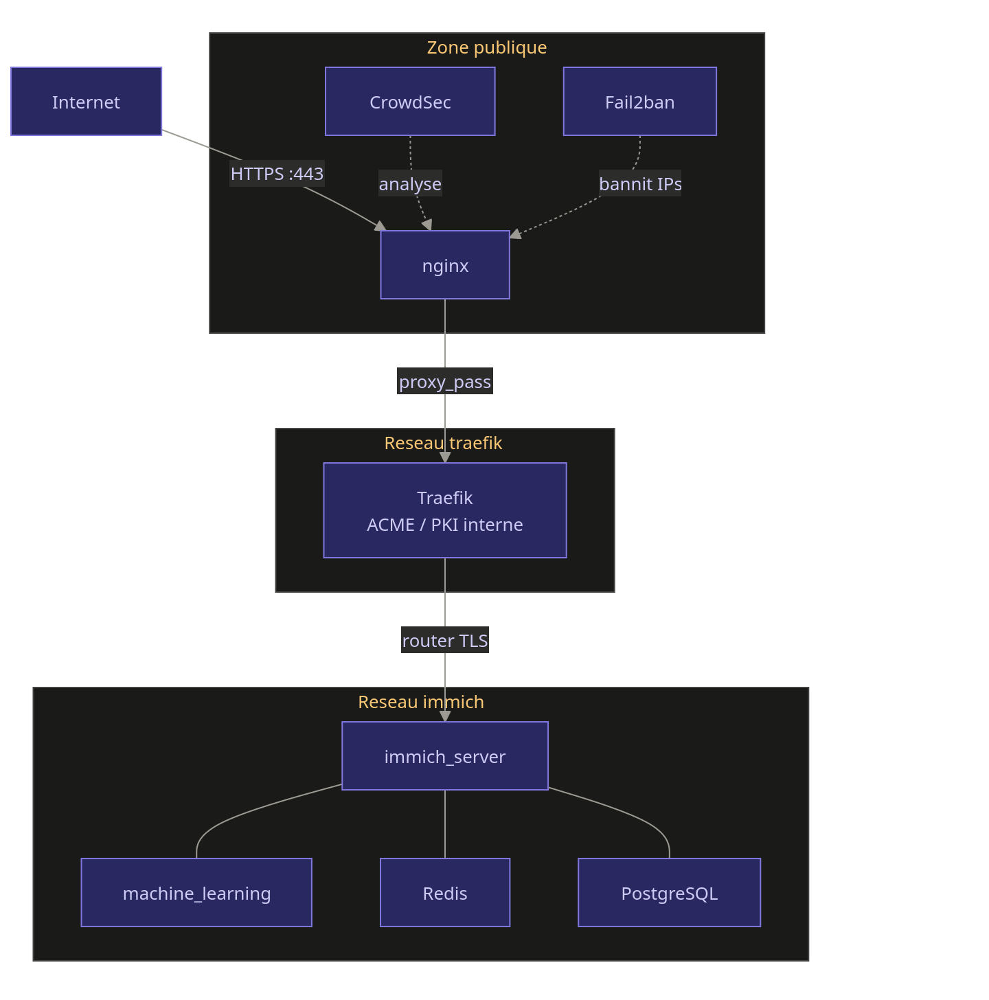

# Principe

Chaque stack est exposée via un traefik qui expose les services en HTTPS, via la PKI interne (serveur ACME step-ca). Le but *in fine* est d'éviter toute rupture HTTPS, même interne.

Ce repo contient uniquement le traefik déployé sur chaque stack.

# Schéma d'infrastructure




# Arborescence :

traefik/
├── compose.yaml
├── acme.json          # touch acme.json && chmod 600 acme.json
└── certs/
    └── ca.crt         # CA root de la PKI

Récupérer le root-ca.crt du serveur ACME pour ajouter la chaine de certificat :

```sh
docker exec traefik sh -c "wget -q --no-check-certificate https://acme.domain.internal/roots -O /certs/ca.crt"
```
