# Principe

Chaque stack est exposée via un traefik qui expose les services en HTTPS, via la PKI interne (serveur ACME step-ca). Le but *in fine* est d'éviter toute rupture HTTPS, même interne.

Ce repo contient uniquement le traefik déployé sur chaque stack.

# Schéma d'infrastructure



# Configuration :

## Cloner le dépot

git clone https://gitlab.com/adenyrr/internal_traefik

## Définir les permissions

```sh
mkdir -p ./data && touch ./data/acme.json && chmod 600 ./data/acme.json
```

## Variables à définir

```sh
cp example.env .env && nano .env
```
TRAEFIK_HOST : URL de contact pour les metrics et l'api traefik
ACME_URL : URL du serveur ACME de la PKI
ACME_EMAIL : mail associé à la PKI

## Récupérer la root-ca pour la chaine de confiance

```sh
# Debian/Ubuntu
apt install -y jq
# Alpine
apk add jq
mkdir certs/
wget -q --no-check-certificate -O - https://acme.<domain>.internal/acme/acme/root \
  | jq -r '.certificate' \
  > ./certs/ca.crt

```

## Lancer le proxy

```sh
docker compose up -d
```

# Utilisation :

## Labels

Pour exposer un service *sur la même machine que le proxy*, il suffit d'ajouter les labels traefik dans la stack, et d'ajouter le conteneur au même réseau que traefik :

```yaml
    networks:
      - (...) # Un conteneur peut appartenir à plusieurs réseaux
      - traefik
    labels:
    - "traefik.enable=true"
    # À modifier : doit correspondre à un enregistrement DNS existant
    - "traefik.http.routers.<service>.rule=Host(`<service>.<domain>.internal`)"
    # Assure un trafic HTTPS
    - "traefik.http.routers.<service>.entrypoints=websecure"
    # PKI interne
    - "traefik.http.routers.<service>.tls.certresolver=internal"
    # Port interne du conteneur
    - "traefik.http.services.<service>.loadbalancer.server.port=<port>"
    # Réseau Traefik
    - "traefik.docker.network=traefik"
```
<service> doit être un identifiant unique par stack — deux services avec le même nom entreraient en conflit dans Traefik.

# Licence

Stack by adenyrr, CC - BY - NC

